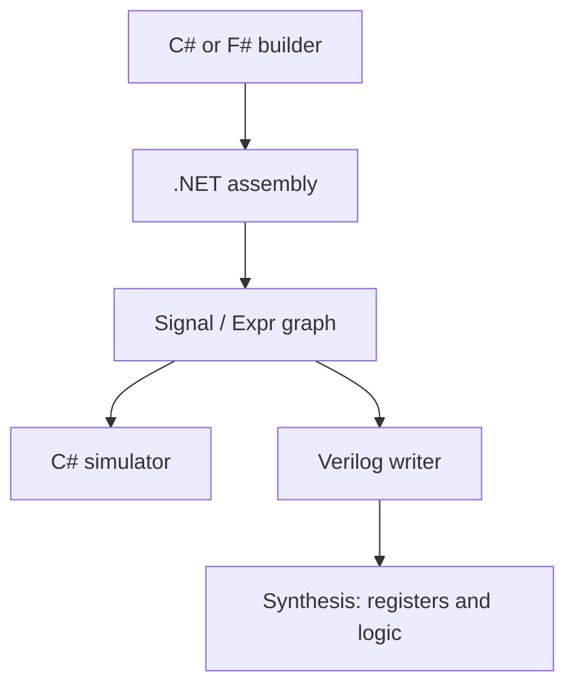

# How SharpHDL works: source code to hardware, with worked examples

This guide follows the actual implementation and generated files in this release.
Where snippets are shortened or calculations idealized, that is stated explicitly.

## Two frontends as of version 0.11

The worked examples below explain the original explicit circuit-builder frontend.
There is now also a real restricted CIL analyzer: see [Behavioral CIL synthesis](BEHAVIORAL_CIL.md)
for actual comparison disassembly, branch-to-mux lowering, constant-loop unrolling,
width contracts and power-of-two arithmetic. Both frontends produce the same Expr
backend. CIL provides software operations; SharpHDL supplies hardware semantics.
[Memory](MEMORY.md) documents the new explicit synchronous RAM interface.

## 1. Three different programs share the work

The C# or F# compiler compiles an ordinary .NET application. Running that
application constructs a hardware graph. SharpHDL checks and traverses the graph
and emits Verilog. A synthesis tool then transforms the RTL into logic and
registers and, in a device-specific flow, maps them to FPGA resources.

| Stage | Consumes | Produces | Responsible tool |
|---|---|---|---|
| Compile the design-builder | C# / F# source | .NET IL assembly | Roslyn / F# compiler |
| Elaborate hardware | Running builder plus parameters | Signal and Expr objects | .NET runtime + SharpHDL API |
| Validate and lower | Explicit hardware graph | Sized RTL operations and Verilog | SharpHDL |
| Synthesize RTL | Verilog | Optimized cells and registers | Yosys or vendor synthesis |
| Implement a target | Synthesized design + device/constraints | Placed/routed FPGA configuration | Vendor implementation tools |

The original examples exercised the first four stages. The later Go Board
classroom target also completed placement/routing and bitstream packing; no
physical-board validation has been performed. No Python, C#, F# or .NET runtime is put into the FPGA.

The graph is an intermediate representation, or IR. An Expr records an operation,
bit width, operands and optional literal/table information. A Signal also records
its role, owner module and driver. In this implementation there is no C#/F# source
parser in SharpHDL: these builder examples use the library API plus operator
overloading. The new behavioral frontend decodes CIL bytes instead.



This separation explains both the small implementation and cross-language support.
The compiler frontend, language runtime, and physical synthesis already exist.
SharpHDL supplies hardware semantics and graph processing between them.

## 2. Worked example: compiling an eight-bit counter

The source is examples/Counter.cs:

```csharp
var m = new Module("Counter");
var enable = m.Input("enable", 1);
var count = m.Register("count", 8, 0);
var output = m.Output("value", 8);
m.NextWhen(count, enable, count + Expr.Const(8, 1));
m.Drive(output, count);
```

### Step A: the language compiler binds the plus operator

Because count derives from Expr and the right operand is Expr, the C# compiler
selects the overloaded Expr addition operator. The semantic effect is a call to
`Expr.op_Addition(count, constant)`. This is a conceptual call spelling, not a
literal IL disassembly from this package.

The actual operator implementation is:

```csharp
public static Expr operator +(Expr a, Expr b)
{
    return Binary("+", a, b);
}
```

Binary checks that the widths match and constructs:

```csharp
return new Expr(a.Width, "+", a, b);
```

The original method also handles comparison-result widths. Crucially, no counter
increment occurs during elaboration. The result is an object describing an
adder. The constant object records width eight and literal value one.

### Step B: NextWhen turns the enable into selection logic

The actual implementation is:

```csharp
public void NextWhen(Signal register, Expr enable, Expr value)
{
    Next(register, Expr.Mux(enable, value, register));
}
```

That adds a Mux node with enable as condition, the sum as the true branch, and
count itself as the false branch. Next stores the resulting expression as the
register's Driver. This feedback describes holding the old value when disabled.
Drive connects the output value port to the count register.

### Step C: inspect the real elaborated graph

The new `m.DumpGraph()` method traverses the actual objects. This is the complete
output in generated/counter.graph.txt:

```text
module Counter
input enable : bits[1]
reg count : bits[8] reset=0
output value : bits[8]
expressions:
e0 : bits[8] const 1
e1 : bits[8] + (count, e0)
e2 : bits[8] mux (enable, e1, count)
connections:
count.next <- e2
value <- count
```

These expression names are dump-local identifiers, not source variable names or
Verilog temporary names. A register reference is a leaf in the combinational
graph: its next-state driver is checked separately. That is why legal register
feedback is accepted while a wire-only combinational cycle is rejected.

Validation also rejects missing drivers, multiple drivers, foreign-module signal
references, invalid widths and assignments to the wrong signal kind. Successful
validation freezes the module structure. It does not perform placement, timing
analysis, general algebraic optimization or automatic pipelining.

### Step D: recursively emit Verilog

The writer visits child expressions before parents. Constants become sized
literals. Signals become prefixed identifiers. Other expression nodes become
sized temporary wires with continuous assignments.

For this exact graph:

| IR object | Emitted representation |
|---|---|
| e0, eight-bit literal one | `8'd1` |
| e1, eight-bit addition | `n_0`, an eight-bit wire |
| e2, eight-bit Mux | `n_1`, an eight-bit wire |
| count, eight-bit register | `reg [7:0] s_count` |
| count.next connection | Nonblocking assignment to s_count at each clock edge |

The relevant actual output from generated/counter.v is:

```verilog
reg [7:0] s_count;
wire [7:0] n_0;
wire [7:0] n_1;
assign n_0 = s_count + 8'd1;
assign n_1 = s_enable ? n_0 : s_count;
assign s_value = s_count;
always @(posedge clk) begin
  if (rst) begin
    s_count <= 8'd0;
  end else begin
    s_count <= n_1;
  end
end
```

The hardware meaning is eight storage bits, increment logic, and hold/update
selection. A target synthesis tool may implement the hold function with a
flip-flop enable instead of a separate feedback multiplexer.

### Step E: the same graph also simulates

The simulator recursively evaluates the Driver expression using current state.
It masks each node to that node's width. It evaluates all registers' next values
before committing any register update, matching nonblocking assignment behavior.

| Before rising edge | Reset | Enable | Next count |
|---:|---:|---:|---:|
| Undefined at startup | 1 | either | 0 |
| 0 | 0 | 1 | 1 |
| 1 | 0 | 0 | 1 |
| 1 | 0 | 1 | 2 |
| 255 | 0 | 1 | 0 |

The final row occurs because `(255 + 1) & 0xff` is zero. No processor executes
an increment instruction in the synthesized circuit; the adder is continuously
connected to the register's output.

## 3. Worked example: why intermediate widths matter

Assume a and b are both eight-bit inputs:

```csharp
var wrapped = (a + b).Resize(9);
var full = a.Resize(9) + b.Resize(9);
```

With a=255 and b=1:

| Expression | First operation | Final result |
|---|---|---:|
| wrapped | Eight-bit sum = 0 | Nine-bit zero |
| full | Widen both operands first | Nine-bit 256 |

For wrapped, SharpHDL must emit an eight-bit temporary for the addition before
assigning it to a nine-bit value. Directly emitting `wide_result = a + b` could
let Verilog expression sizing use the wider destination context and change the
result. The explicit temporary is a semantic boundary, not merely formatting.

For every simulator node, the implementation finishes with:

```csharp
v &= Expr.Mask(e.Width);
```

The corresponding sized wire in the HDL enforces the same truncation. The
baseline regression specifically compares narrow-then-wide and wide-before-add.

Signed values remain bit patterns. `SignExtend` and `ArithmeticShift` explicitly
request signed operations. For example, a 16-bit -2 is 0xfffe; sign extension
produces 0xfffffffe, while zero extension produces 0x0000fffe. The Verilog writer
uses `$signed(...)` where signed interpretation is required.

## 4. Worked example: F# generates a four-tap FIR

The builder uses coefficients [1;3;3;1] and a three-register delay line. Its
expression-building code, copied from examples/FSharp/Designs.fs, is:

```fsharp
let compute (sample: Expr) =
    List.zip coefficients (sample :: List.map expr delays)
    |> List.map (fun (c, x) -> x.SignExtend(32) * signed 32 c)
    |> List.fold (fun sum product -> sum + product) (bits 32 0)
```

The F# compiler compiles this function into .NET code. SharpHDL's Map factory
calls the delegate during elaboration with its input Data signal. The function
runs once to build the expression structure:

1. List.zip pairs coefficients with the input and delayed samples.
2. List.map constructs four sign extensions and four multiplication expressions.
3. List.fold constructs an initial zero addition and three further additions.
4. Map registers the result and adds valid/ready, Keep, Last and User handling.

The FIR equation is:

    y[n] = x[n] + 3*x[n-1] + 3*x[n-2] + x[n-3]

Here is the actual arithmetic portion of generated/fsharp/FsFir.v:

```verilog
assign n_10 = $signed(s_s_axis_tdata);
assign n_11 = n_10 * 32'd1;
assign n_12 = 32'd0 + n_11;
assign n_13 = $signed(s_delay_1);
assign n_14 = n_13 * 32'd3;
assign n_15 = n_12 + n_14;
assign n_16 = $signed(s_delay_2);
assign n_17 = n_16 * 32'd3;
assign n_18 = n_15 + n_17;
assign n_19 = $signed(s_delay_3);
assign n_20 = n_19 * 32'd1;
assign n_21 = n_18 + n_20;
```

All those n_ wires are 32 bits. The delays are 16-bit registers. The graph dump
in generated/fsharp/FsFir.graph.txt records the sign extensions, products, sums,
register drivers and handshakes before HDL generation.

### A numeric sample sequence

Starting with zero history, accept samples 8,0,0,0,0:

| Accepted input | Previous three samples | Weighted sum |
|---:|---|---:|
| 8 | 0,0,0 | 8 |
| 0 | 8,0,0 | 24 |
| 0 | 0,8,0 | 24 |
| 0 | 0,0,8 | 8 |
| 0 | 0,0,0 | 0 |

These are raw gain-eight outputs. An arithmetic shift by three would normalize
the gain. The state advances on accepted samples, not on every wall-clock tick.

### What happens if the output stalls?

Map implements:

```text
available = !output_valid OR output_ready
input_ready = available
load = available AND input_valid
```

When output_valid=1 and output_ready=0, available=0. The output data/metadata
registers hold, input_ready goes low, and the FIR delay line also holds because
its enable is input_valid AND input_ready. On a later edge with output_ready=1,
the old output can be consumed and a new input accepted into its place.

The arithmetic operations are continuously present. The handshake decides
when their results become an accepted output sample.

### What synthesis changed

The actual Yosys RTL statistics in generated/synthesis/FsFir.log report:

| RTL cell type | Count |
|---|---:|
| $add | 3 |
| $mul | 2 |
| $and | 1 |
| $not | 1 |
| $or | 1 |
| $sdffe | 8 |

Synthesis removed multiplication by one and addition of zero. It retained two
constant multiplications by three at this RTL synthesis stage. Later target
mapping could implement them as shift/add logic or other resources. `$sdffe`
counts vector register cells, not individual flip-flops. These counts are not
FPGA LUT counts or a timing result.

This distinguishes responsibilities: F# builds the repeated structure, SharpHDL
preserves its widths/state/handshakes, and synthesis optimizes the emitted RTL.

## 5. Worked example: a cosine call becomes CORDIC hardware

```csharp
var result = HwMath.Cos(m, angleStream, "cosine");
```

This calls a hardware builder. It is not a rewrite of System.Math.Cos. The builder:

1. Checks the 24-bit phase format and iteration count.
2. Calculates the CORDIC gain-compensation and arctangent constants in host math.
3. Builds a range-reduction stage.
4. Runs an ordinary C# construction loop to instantiate 20 rotation stages.
5. Projects the cosine component onto a 32-bit result stream.

Each stage contains registers and expressions for these equations (idealized
mathematical notation; implementation uses finite signed bit vectors):

```text
if z >= 0:
    x_next = x - (y >> i)
    y_next = y + (x >> i)
    z_next = z - atan(2^-i)
else:
    x_next = x + (y >> i)
    y_next = y - (x >> i)
    z_next = z + atan(2^-i)
```

The x/y shifts are arithmetic. The arctangent constants are represented in
24-bit turns, and x/y have 24 fractional bits. These are simultaneous next-state
equations: y_next uses the old x, not x_next.

For an angle of zero, the initial idealized values are x≈0.607253, y=0, z=0.
The first rotation produces x≈0.607253, y≈0.607253, z=-pi/4. The next rotation
reverses direction, moving x toward 1 and y toward 0. Later stages make finer
corrections. The implemented constants and every update are quantized.

The construction loop executes on the host and leaves 20 distinct rotation
stages in the circuit. The hardware therefore has 21 pipeline stages including
range reduction. It can accept one sample per unstalled clock, although one
sample takes 21 accepted pipeline edges to reach the output without stalls.
No multiplier is required for those runtime shifts and additions.

The F# oscillator demonstrates composition: a phase register emits successive
angles into this same CORDIC. The phase counter and eight-bit sample tag advance
only when that input stream accepts a sample.

## 6. Worked example: ROM interpolation for a reciprocal

The normalized reciprocal function takes a 16-bit fraction f and interprets:

    x = 1 + f/65536, with 1 <= x < 2

With the default eight address bits, the upper eight input bits select a table
segment and the lower eight select a position inside it. The table is generated
at elaboration time from host Math calls. Its integer values are embedded into
Verilog case functions; no Math library exists in the hardware.

Take f=32896:

| Quantity | Value |
|---|---:|
| Input x | 1.501953125 |
| Segment address | 128 |
| Fraction within segment | 128/256 = 1/2 |
| Q4.20 base at x=1.5 | 699051 |
| Q4.20 value at the next endpoint | 697235 |
| Signed delta | -1816 |
| Interpolated result | 699051 + (-1816*128 >> 8) = 698143 |
| Decoded output | 0.6658010482788086 |
| Mathematical reciprocal | 0.6657997399219766 |

The hardware has one stage for base/delta/offset and one for interpolation.
Sign extension matters because a reciprocal table has negative deltas. Its
signed multiply result is arithmetic-shifted before addition to the base.

The alternative PolynomialMath builder generates coefficients and a Horner
pipeline. For coefficients c0..cn, it builds repeated steps:

```text
accumulator = cn
accumulator = accumulator * centered_x + c(n-1)
...
accumulator = accumulator * centered_x + c0
```

Each loop iteration creates a stage. Products use explicit fixed-point widths
and shifts. This captures the range-reduction/coefficient-evaluation approach
associated with small ROM math libraries, with new coefficients and a hardware
pipeline rather than bit-exact emulation of the Level II routines.

## 7. Worked example: a packet becomes one peak summary

examples/PacketPeak.cs builds two state registers and one elastic output stage.
For samples -3,7,-8 with Last on the third input, the next-state arithmetic is:

| Accepted sample | Magnitude | Peak including sample | Count including sample | Output |
|---:|---:|---:|---:|---|
| -3 | 3 | 3 | 1 | None |
| 7 | 7 | 7 | 2 | None |
| -8, Last=1 | 8 | 8 | 3 | 0x00030008 |

On the final acceptance, the peak and count registers clear for the next frame.
The summary register simultaneously captures the computed old-frame result.
The emitted summary retains the final input's User metadata.

The construction uses comparisons, Mux nodes, addition, concatenation and an
elastic stage. It does not run a software loop over stored packets. This example
also demonstrates a many-input-to-one-output function: a stream interface does
not require equal input and output transaction counts.

## 8. How we check that the compiler preserved behavior

The same IR powers the C# simulator and HDL writer, so matching those two alone
would not rule out a shared semantic mistake. The tests additionally compare
results against independent references: integer FIR arithmetic, packet queues,
software CRC and System.Math trigonometric/normalized math.

For each design, the test generator records inputs and expected port values into
a self-checking Verilog testbench. Icarus runs the emitted Verilog independently.
For selected designs, Yosys synthesizes the RTL and the resulting RTL netlist is
run against the same testbench again. This caught a ROM initialization issue
during development and exposed a Yosys automatic-ROM conversion limitation.

The F# examples were actually compiled and executed on .NET 8 and their generated
Verilog passed both direct and post-synthesis simulation. The direct build route
is included because CLI/MSBuild startup in this container cannot inspect process
metadata; the SDK compiler assemblies and runtime work.

These checks are regressions, not formal equivalence or a target timing proof.
No automatic architecture selection, resource sharing, arbitrary source-code
conversion, floating-point exception system or FPGA place-and-route is implied.

## 9. Inspect the compiler yourself

Useful source entry points:

| File / method | Responsibility |
|---|---|
| Hardware.cs / Expr operators | Create graph nodes and establish width rules |
| Hardware.cs / Module.Next, Drive | Record register and combinational drivers |
| Hardware.cs / Module.Validate | Validate connectivity and combinational cycles |
| GraphDump.cs | Print the actual elaborated graph |
| Hardware.cs / Simulator.Eval, Tick | Evaluate expressions and commit simultaneous state |
| Hardware.cs / VerilogWriter.Emit, Write | Emit sized expressions, ports and clocked RTL |
| Streams.cs / StreamBlocks.Map | Construct one elastic pipeline stage |
| MathHardware.cs / HwMath.SinCos | Elaborate a CORDIC stage chain |
| MathHardware.cs / RomMath, PolynomialMath | Build table/interpolation or Horner hardware |

To save both representations from any builder:

```csharp
File.WriteAllText("design.graph.txt", m.DumpGraph());
File.WriteAllText("design.v", m.Verilog());
```

The generated graph files, Verilog, testbenches, synthesis logs and synthesized
RTL in this archive are actual outputs from the supplied builders. They let you
follow the transformation without taking the explanation on trust.

## 10. A configuration-driven dataflow application

The new [F# filter-bank walkthrough](examples/FSharp/DATAFLOW_AND_USEFULNESS.md)
follows a sensor stream through broadcast, parallel filters, queues, channel tags,
and a merge tree. It explains where this is useful, how backpressure prevents
loss/duplication, and why a four-to-one result merger limits the input rate.
The same builder produced tested two-, three- and four-channel circuits.

## 11. A controller rather than a data-processing pipeline

The [C# debug-UART mini controller](examples/DEBUG_UART.md) shows explicit state,
command decoding, reply byte selection, coherent counter snapshots and reply
backpressure. Its byte-level FSM is generated by SharpHDL. The serial adapter is
hand-written RTL, so the example also shows integration with conventional modules.
See [the Verilog comparison](examples/Verilog/README.md) for a hand-authored version
of the filter bank that passed the same trace as the generated implementation.


## Typed arithmetic and skid buffering (0.6)

The same construction mechanism now powers `UInt<W12>`, `SFixed<W24,F16>` and
`FloatValue`. See [the worked numeric guide](NUMERIC_TYPES_AND_MATH.md) for
exact width-growth, fixed-point rounding, float packing and streamed complex
power examples. The C# compiler resolves the overloaded operations; library
methods build sign extensions, multipliers, normalizers, ROMs and muxes.

[The skid-buffer guide](SKID_BUFFER_AND_VERILOG_COMMENTS.md) follows two beats
through a downstream stall, and shows how C# register updates become a
simultaneous next-state circuit with fully documented packed payload fields.


## Three frontends and the common hardware graph

[The three-language worked example](examples/ThreeLanguages/README.md) contains
actual C#, F# and VB source, compiled CIL disassembly, identical elaborated
graphs, generated Verilog and an iCE40 primitive netlist. It explains why CIL
enables interoperability while SharpHDL still builds its own hardware IR.
The same guide connects an F# stage to the C# skid buffer and a VB stage,
then shows how one versus two C# Map calls change the register boundaries.

## Why SharpHDL and what it won't synthesize

The .NET compiler handles the source language; executing its CIL constructs the
circuit through SharpHDL's API. The hardware graph is built by the library, not
recovered by a general CIL synthesis engine. Read [the explicit boundary and
rationale](SYNTHESIS_BOUNDARIES.md), including host loops, muxes and state examples.
[Integer division](INTEGER_DIVISION.md) shows how one ordinary builder call can
select unrolled combinational logic or an iterative state machine, and how rounding
and transaction timing become part of that block's contract.
