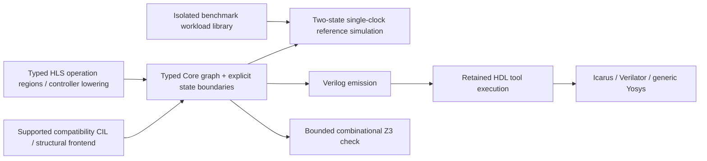

# SharpHDL modular architecture and migration

> Current status is summarized in the 2026-10-27 continuation at the end of this
> document. Earlier dated migration statements are historical, not current closure.

## Decision (2026-10-14)

One repository, three primary assemblies:

| Assembly | Ownership | Reference rule |
|---|---|---|
| `SharpHDL.Core` | Hardware types, versioned IR contracts, validation, structural primitives and backends' common semantics | No dependency on HLS or Simulation |
| `SharpHDL.HLS` | CIL language analysis, processes, scheduling and high-level hardware lowering | References Core |
| `SharpHDL.Simulation` | Reference interpreter, compiled simulator, event-breakpoints, replay and trace engines | References Core |

Support products, including Verilog exporter, VS Code extension, live debugger and tests, remain in the same repository.

## Migration status

**The project scaffolding and dependency direction are committed; implementation migration is NOT finished.** The existing `src/SharpHDL/SharpHDL.csproj` is preserved as the compatibility assembly and still contains the historical structural, HLS, simulator and Verilog implementation. New assemblies currently contain initial contracts, not duplicate implementations. The new `HardwareNode` representation is *not yet connected* to the production compiler. No class has been claimed migrated based on creating its destination project alone.

This staged approach avoids breaking public consumers while extensive `internal` references and combined source files are untangled. The key follow-on work is a real migration with end-to-end tests:

1. Inventory ownership and internal dependencies among current source files. Keep hardware semantics explicit and invariant across existing frontends.
2. Move the foundational expressions, signals, registers, RAM model and typed IR into Core. Separate Verilog emission from simulator evaluation; preserve public signatures through compatible references or documented forwards.
3. Move CIL/process frontends, pipeline scheduler and high-level numerical kernels into HLS. Both high-level and explicit structural interfaces must produce the same canonical IR.
4. Move reference and compiled sequential engines, checkpoints, debug session, waveforms and breakpoints into Simulation. Do not duplicate simulator state or depend on HLS types.
5. Update all example/test project references and assembly usage. Add clean-clone build, binary compatibility tests, C# / F# / VB smoke tests, CPU/UART differential simulation and a dependency-cycle test.
6. Retire the old assembly only with compatibility evidence and a migration version; don't silently break existing packages or example code.

### Build

```sh
make setup
just build
make container-verify
```

The provisioning script restores the new three projects along with the legacy projects. The `just build` and container smoke workflow compile them. Docker is still the bootstrap prerequisite for automated tool provisioning. New build/test results are not verified in this session.

## Explicit non-goals

We are not creating three repositories or three competing hardware languages. HLS and the structural API remain complementary authoring styles. The simulator runs the elaborated hardware design, never the source-level CIL application as though it were ordinary software.

## 2026-10-14 Core IR implementation increment

`src/SharpHDL.Core/HardwareGraph.cs` is a real backend-neutral immutable topological graph validator. It checks nonnegative unique node IDs, earlier-node-only operand references (rejects cycles and forward references), widths 1–4096, binary/unary/mux operand signatures and explicit unsupported operation types. `CoreHardwareGraphTests` is included in the existing xUnit suite through a direct Core project reference. `tests/check-project-layers.py` enforces HLS→Core and Simulation→Core references with no unexpected cross-layer dependencies; container smoke runs this check.

**Not yet migrated:** Production `Module`/`Expr`, CIL lowering, `Simulator`, Verilog and debugger types still live in the compatibility assembly. The new graph is not yet wired to synthesis or simulator execution. Existing end-to-end tests are not known to have passed after this change. The next extraction must use a genuine shared IR adapter without duplicate hardware state or breaking consumers; binary compatibility implications require explicit review.

## 2026-10-15 — first production graph-to-Core lowering

The legacy compatibility assembly now references `SharpHDL.Core` and exposes
`Module.ExportCoreGraph()`. This performs **real lowering** of a validated
production `Module` into the immutable, width-checked Core graph for the
currently supported expression subset: input/state, constants, add/subtract,
multiply, bitwise AND/OR/XOR/NOT and mux. Combinational outputs and register
next-state cones are included; pre-edge register state is represented as an
explicit input boundary. Literal values and signal names are preserved.

`SharpHDL.Simulation.HardwareGraphEvaluator` evaluates this canonical graph
without depending on the legacy assembly or HLS frontend. Arithmetic is
two-state, unsigned and masked to the declared hardware width. A differential
test compares the new evaluator with the original simulator for 300 clock
edges, including a stateful 8-bit multiply-accumulate with enable control.
Additional tests reject unsupported operators, missing input state and
out-of-range values. The new evaluator is an independent combinational
snapshot evaluator; the original simulator remains responsible for memory,
clock scheduling and other unsupported operations.

**Migration status:** This is a supported-subset compatibility bridge, not
a claim that all legacy hardware now executes through Core. In particular,
shifts, slices, comparisons, signed operations, RAM, DSP primitives,
concatenation, pipeline control and multi-clock semantics are not yet lowered
by `ExportCoreGraph`; those fail explicitly rather than being silently
misrepresented. HLS production scheduling and legacy simulator implementations
have **not** moved to their new assemblies. The next steps are extending the
canonical operation contract and lowering to cover full TinyRisc, then moving
simulation execution and frontends without breaking the public API. Keep
issue #24 open until end-to-end parity and clean builds pass.

## 2026-10-15 — expanded canonical operations and synchronous memory

The production `Module.ExportCoreGraph()` bridge now lowers constant shifts
(left, logical right, arithmetic signed right), slices, resizing, sign
extension, concatenation, equality and signed/unsigned comparisons, ROM
lookup, full-precision direct DSP48E2 multiplication, and RAM read expressions
in addition to the earlier arithmetic and mux subset.

The `HardwareGraph` validator checks operation-specific widths, slice
ranges, constant shift offsets, ROM contents/address capacity, DSP48E2
unsigned 26x17 limits, and explicit RAM identities. Immutable ROM and RAM
initialization payloads are copied on export. No missing memory values are
treated as zero.

RAM is represented with `HardwareMemoryPort` (read/write address, enable,
data and initial contents). `HardwareGraphEvaluator` reads a supplied
pre-edge RAM snapshot; `HardwareMemoryTransitions.Commit` separately applies
the evaluated writes and returns a new immutable snapshot. This preserves
synchronous read-before-write behavior, including disabled reads and writes.
Reset behavior remains owned by the sequential controller: resetting clears
the RAM output register but does not clear the memory cells.

Differential tests now cover 300 random bitfield/ROM vectors, direct DSP
arithmetic, and 180 RAM cycles with simultaneous read/write and disabled
read cases. These tests are part of `make core-ir-verify`.

**Still not migrated:** the main legacy simulator's event loop, HLS CIL
compiler/scheduler, the Verilog backend, and broader memory/bus/multiclock
semantics. The canonical evaluator is independent but not yet the default
runtime. End-to-end test status must be checked against CI before closing
issue #24.

### TinyRisc16 end-to-end canonical-IR regression

The unit suite now compiles the real `examples/TinyRisc/TinyRisc.cs`
design and exports its full combinational, register, ROM and scratch-RAM
cones into Core. The regression compares output ports against the legacy
simulator over 60 clock edges with a NOP/NOP/HALT program. It applies
register next-state values and RAM writes through the independent Core
evaluator/transition APIs and uses actual ROM lookup and synchronous
read-before-write semantics. This is a **differential verification path**,
not yet a replacement for the production simulator.

Run `make core-ir-verify` for the Core IR validation, arithmetic, memory
and TinyRisc parity tests. The full xUnit workflow additionally checks
Windows and Linux. Results for this newly added TinyRisc canonical test
must be confirmed from the corresponding CI run before declaring acceptance.

### Clocked canonical simulation engine

`SharpHDL.Simulation.HardwareGraphMachine` now executes a complete
two-state clock step directly from Core IR. It owns external input values,
register state and immutable RAM snapshots; `Tick()` evaluates all
combinational cones from pre-edge state and atomically commits register
next-state and RAM writes. `Reset()` resets registers without erasing
RAM cells, as in the original simulator. `ReadOutput()`,
`ReadRegister()` and `SetInput()` expose a minimal independent runtime.

A new 120-cycle RAM/register differential regression compares this clocked
machine against the original `Module.Simulate()` implementation, including
read-before-write and RAM retention across reset. The compatibility
`Module` still performs the initial lowering, but the new clocked
execution itself has **no reference to legacy Module or HLS**. This is
the first independently usable sequential simulation engine in the
Simulation assembly. Multiclock, four-state, waveform and rewind behavior
remain on the legacy path pending migration.

## 2026-10-15 — production compatibility and first independent HLS consumer

The existing `SharpHDL.Module` API now offers
`module.SimulateCore()`, a compatibility factory that exports its
validated design into Core IR and constructs a
`SharpHDL.Simulation.HardwareGraphMachine`. The independent engine
owns all clock stepping, RAM snapshots and register commits; the
legacy assembly supplies only the initial lowering. Existing
`module.Simulate()` remains unchanged for regression comparison.
An 80-cycle TinyRisc16 test drives both engines through the public
factory and compares output ports at every clock edge.

The `SharpHDL.HLS` assembly now contains
`HlsGraphAnalyzer.Analyze(HardwareGraph, stageBudget, HlsCostProfile)`,
the first independent HLS pass over **real production canonical IR**.
It analyzes operation dependency paths, separately counts ordinary
multiply and direct DSP nodes, and reports an abstract critical-path
cost and suggested stage count. Unlike the legacy depth-only policy,
multiplication, DSP multiplication, add/compare and memory operations
can have distinct configurable weights. The pass is tested against
real `Module.ExportCoreGraph()` output, including TinyRisc16 and
direct DSP multiplication.

**Important distinction:** HLS graph analysis does not insert
pipeline registers, change initiation intervals, or guarantee timing.
Its costs are arbitrary planning units, not characterized target
delays. The legacy production CIL pipeline scheduler remains in
place until a compatible IR-driven ready/valid scheduling backend
is implemented and differentially verified.

Standalone Roslyn C#/F#/VB build scripts now include the independent
Simulation source files to preserve clean-checkout compilation of
the compatibility API. `make core-ir-verify` includes the new HLS
analysis and TinyRisc compatibility regressions.

### Canonical IR optimization pass

`SharpHDL.HLS.HlsConstantFolder.Fold(graph)` now implements an
independent, side-effect-free HLS optimization on validated Core IR.
It folds fully constant arithmetic (with modulo-width truncation),
bitwise logic, comparisons, mux, shifts, slices, concatenation,
sign-extension and ROM lookup. It preserves every node ID and
source name so port maps and provenance references remain stable.
Register/state boundaries and RAM reads/writes are never folded.

This is an actual transformed graph, not a report. Tests compare the
folded graph's output with the legacy simulator over boundary values
and confirm that RAM and register inputs are preserved. It remains
opt-in while HLS lowering and Verilog generation are migrated;
the existing CIL frontend does not silently switch to the new pass.

## 2026-10-15 — first actual Core IR elastic HLS compiler

`SharpHDL.HLS.HlsElasticCompiler.Compile(graph, inputNodeId,
outputNodeId, stageBudget, profile)` now performs an **actual clocked
hardware transformation** in the independent HLS assembly. It lowers
a stateless, single-input Core IR expression DAG into a new canonical
`HardwareGraph` containing payload registers, valid bits, combinational
backpressure-ready propagation, next-state muxes and named input/output
ports. It is not merely a scheduling report.

The compiled result exposes `Graph`, `Inputs`, `Outputs`,
`NextState`, `ResetValues`, `Latency`, `InitiationInterval=1`
and `PayloadRegisterBits`. It runs directly in the independent
`HardwareGraphMachine`, preserving token order and values under
randomized ready/valid stalls. Individual operations whose abstract
cost exceeds the configured stage budget are **rejected**, not
silently split into unverified multicycle hardware.

The legacy compatibility assembly adds
`HlsPipelineCompatibility.ToModule(compiled, name)`, which maps
the compiled Core IR back into the existing, proven Verilog emitter.
This bridge preserves all register and handshake logic, and will
be retired once the Core-native RTL backend is qualified.
`tools/SharpHDL.CoreHlsDemo` demonstrates C# expression -> Core IR ->
registered elastic Core IR -> Verilog. The testbench
`tests/rtl/tb_core_hls_elastic.sv` exercises the resulting RTL under
randomized backpressure using Verilator.

Use `make core-hls-verilator` for the full hardware regression or
`make core-ir-verify` for Core/HLS/Simulation unit parity.

**Scope limits:** this compiler currently accepts one input token and
one result expression. It rejects external state, RAM, direct DSP
primitive nodes and operators too expensive for one stage. It does
not yet replace the existing CIL stream-loop compiler, perform
resource sharing, support multicycle II, or characterize physical
FPGA timing. The production `CilCompiler.AttachPipeline` remains
unchanged pending differential qualification of these features.

## 2026-10-15 — legacy RTL isolation and independent Core-native RTL

The original Verilog emitter has been **physically extracted** from
`src/SharpHDL/Hardware.cs` into
`src/SharpHDL.LegacyRtl/LegacyVerilogWriter.cs`. It is still compiled
into the legacy compatibility assembly using an explicit linked source
entry in `SharpHDL.csproj`, rather than a project reference that would
create a dependency cycle. `Module.Verilog()` remains the same public
API and calls the relocated legacy writer. Its implementation and
generated Verilog behavior are deliberately retained for differential
verification. All six standalone direct Roslyn build paths were
updated to include the relocated source.

A separate `src/SharpHDL.RTL` assembly now implements
`CoreVerilogEmitter.Emit` with a **Core-only dependency**. It emits
single-clock synthesizable Verilog directly from validated canonical
Core IR, including registers, synchronous reset, arithmetic,
comparisons, bitfield operators and muxes. It does not reference
legacy `Module`, the HLS compiler or the simulation engine. RAM,
ROM lookup, direct DSP primitives and other unsupported operations
currently produce explicit diagnostics.

`tools/SharpHDL.CoreHlsDemo` generates two independent RTL files
from the same compiled elastic Core IR graph:
`generated/core-hls/CoreHlsElastic.v` (preserved legacy writer) and
`generated/core-hls/CoreHlsElasticNative.v` (new Core-native writer).
The same randomized ready/valid and reset testbench runs against both
backends under Verilator. `make core-hls-verilator` verifies the
legacy route; `make core-rtl-native` verifies the new backend.
The xUnit workflow has a dedicated `core-rtl-native` acceptance job.
Native RTL acceptance passed in [run 38823125300](https://github.com/jeffadickson/SharpHDL/actions/runs/38823125300): both old and new emitters completed 303/303 randomized transactions with stall, drain and reset checks. Ubuntu/Windows xUnit and architecture layering also passed.

The long-term dependency direction is Core <- HLS, Simulation and
RTL; the compatibility assembly references the new subsystems but
continues to contain the original public API and legacy RTL writer.
Once Core-native RTL covers RAM/DSP and all production designs,
we can retire the source-linked legacy emitter without breaking
the `Module.Verilog()` compatibility contract.

## 2026-10-15 — native TinyRisc16 ROM/RAM and full UART acceptance

The independent `SharpHDL.RTL.CoreVerilogEmitter` now accepts the
canonical `HardwareMemoryPort` map and emits initialized ROM lookup
functions (with zero for out-of-range addresses) and initialized,
single-port synchronous RAM. RAM reads are combinational views of the
pre-edge array, captured by the existing Core IR read-data register;
writes occur at the rising edge, suppressed by reset and out-of-range
addresses. RAM cells retain their values through synchronous reset.
This preserves the existing read-before-write contract.

`tools/SharpHDL.NativeTinyRisc` constructs the **real** 33-word
Hello World TinyRisc16 program and exports its full canonical graph
(428 nodes and one scratch RAM) directly through the native Core RTL
backend. It generates `generated/tinyrisc/native/HelloWorld.v`.

`tests/run-tinyrisc.sh` executes the same two existing independent
Icarus testbenches against **both** the preserved legacy and the new
native RTL: the complete CPU cycle-by-cycle output oracle and the
8N1 serial UART top-level test expecting `Hello, world!\r\n`,
HALT and no fault. Both native benches passed in
[run 38825376134](https://github.com/jeffadickson/SharpHDL/actions/runs/38825376134).
The additional native Yosys `hierarchy -check; proc; opt; check -assert`
gate passed in
[run 38825395067](https://github.com/jeffadickson/SharpHDL/actions/runs/38825395067).
These results establish behavioral equivalence for this design, not
formal equivalence for all possible programs or physical FPGA timing.

Run `make tinyrisc-hello` to exercise both backends, including
UART and Yosys checks. The legacy emitter is retained as an oracle.
Direct DSP48E2, multiport memories and broader backend capabilities
remain for further migration.

## 2026-10-19 — scheduled state machines lower directly to Core IR

`SharpHDL.HLS.ScheduledMachineBuilder` is an algorithm-neutral control and
datapath representation. It declares typed values, resettable registers,
finite states, guarded assignments and transitions, and synchronous
single-port RAM reads and writes. Lowering creates only canonical
`HardwareGraph`, named boundary maps and `HardwareMemoryPort` metadata.
HLS therefore remains independent of the legacy structural frontend,
simulation and RTL assemblies.

Each RAM access is attached to a schedule state. Lowering rejects more
than one access to the same single-port memory in a state. A read captures
the pre-edge RAM value into an explicit register, preserving one-clock
synchronous latency; writes commit after pre-edge evaluation. Guarded
transitions hold the current state when no condition fires, which provides
ready/valid backpressure without a backend-specific scheduling rule.

`HlsScheduledFirCompiler` is the first client. It maps the existing
single-port FIR schedule to one state per clock slot and explicitly
arbitrates all tap operands onto one multiplier. The resulting Core IR is
simulated by `HardwareGraphMachine` and emitted by `CoreVerilogEmitter`.
The legacy four-tap FIR remains an independent transaction-level oracle.

## 2026-10-15 — production CIL frontend connected to Core elastic HLS

The existing `CilCompiler.AttachPipeline` now accepts
`new PipelineOptions { UseCoreCompiler = true }`. The **same**
production CIL decoder parses `HwStream<T>.Read/Write`, branches,
fixed-width arithmetic and C# loop structure, then lowers the
resulting token expression using `CoreTokenLowering` directly into
canonical `HardwareGraph`. No temporary Module output is added.

`SharpHDL.HLS.HlsElasticCompiler` creates actual registered
ready/valid hardware with stalls, token ordering and II=1.
`CorePipelineAttach` binds its register/next-state graph into the
original Module's existing stream ports, while preserving the
`PipelineHandle`, operation graph and source-map annotation path.
The legacy `PipelineScheduler` remains available as the default
until full CIL compatibility qualification. No silent fallback is
performed if Core compilation rejects an unsupported feature.

The initial Core CIL mode deliberately rejects DSP-preference hints
that cannot be preserved and remains stateless, single-input,
single-output and II=1. This is a real production-frontend integration,
not yet a replacement for feedback, multicycle resource sharing or
every legacy scheduler feature. Stage costs are abstract operation
counts, not physical timing.

`tools/SharpHDL.CilCoreDemo` generates legacy and native Core RTL
from an actual C# `while(true)` stream method, and
`tests/rtl/tb_cil_core.sv` checks both against a software arithmetic
oracle with randomized backpressure, drain and stalled reset.
Run `make cil-core-verilator` or the `cil-core-verilator` CI job.
The C# xUnit suite additionally checks real CIL arithmetic and
conditional-branch pipelines across 900 simulated clock cycles.
The CI results for these new tests must pass before this milestone
is declared verified.

## Scheduled table example (2026-10-26)

`examples/ScheduledTable.cs` exercises the same scheduled Core IR builder without
FIR policy. It accepts a key, 16-bit delta and update flag; it reads a synchronous
RAM word, optionally adds modulo 65536 and writes it, then holds the response
until accepted. Address widths 1 through 8 are supported. The no-stall initiation
interval is four edges; response valid appears three edges after acceptance.
Reset aborts in-flight responses, suppresses writes on the reset edge and retains
previously committed RAM words. A reset after commit may therefore suppress the
response while retaining the update; callers must account for reset epochs.

The independently specified array/protocol oracle lives in
`tests/Shared/ScheduledTableCampaign.cs`. Tests and the RTL generator share this
oracle, not DUT implementation logic. Seeds are 261026 + address width. Each run
contains 3201 edges, reset every 151 traffic cycles, repeated/boundary addresses,
read-only requests, overflow and response stalls. Generation fails on mismatch.
The replay additionally checks every RTL output after every edge against Core.

From a checkout on Linux with .NET 10 and Icarus:

```sh
test -d tests/SharpHDL.UnitTests && dotnet test tests/SharpHDL.UnitTests/SharpHDL.UnitTests.csproj -c Release --filter FullyQualifiedName~ScheduledTableTests
test -d tools/SharpHDL.AxiFirRtlDemo && dotnet run --project tools/SharpHDL.AxiFirRtlDemo -c Release -- --table generated/scheduled-table
for width in 1 4 8; do
  iverilog -g2012 -s tb -o "/tmp/table-$width" "generated/scheduled-table/ScheduledTable$width.v" "generated/scheduled-table/ScheduledTable${width}_tb.sv" && vvp "/tmp/table-$width" || exit 1
done
yosys -p 'read_verilog generated/scheduled-table/ScheduledTable4.v; hierarchy -check; proc; opt; memory_collect; check -assert; stat'
```

Local Icarus 12.0 passed all three replays (421, 418 and 414 completed responses).
Yosys 0.33 retained one `$mem_v2` cell and one `$add` after `memory_collect` for
the 16-word case. This is generic synthesis evidence, not vendor BRAM placement,
physical timing closure or formal proof. No automatic CIL extraction or resource
binding is introduced. SCHED-011 remains partially verified because explicit
resource-capacity/latency assertions and broader qualification remain open.

## Follow-up item 1 — typed arithmetic resources

ScheduledMachineBuilder.ArithmeticResource declares combinational unsigned
Add/Subtract/Multiply instances with exact operand/result width and capacity.
ScheduledState.Compute binds an operation; generic lowering now owns both operand
selection and result routing. A result is zero outside its state/guard. Register
capture is required between bound operations, so binding cannot form a resource
arbitration cycle. Declaration order deterministically assigns lanes. Guards do
not permit capacity overbooking. No device timing or iterative operator latency
is inferred. FIR now uses this generic binding instead of handwritten muxes.

Acceptance tests cover two simultaneous instances reused in another state, all
byte inputs, guard gating, modulo arithmetic and rejected foreign, incompatible,
chained or oversubscribed bindings. Per user cadence, tests execute at the end;
final execution results are in FOLLOWUP_2026-10-27.md.

## Follow-up item 3 — stateful CIL to scheduled Core

CilCompiler.BuildScheduledSequential is an explicit opt-in path reusing Decode,
PopCount, PushCount and Successors from the production CIL frontend. It emits
ScheduledMachineBuilder states rather than lowering a legacy Module graph.
Supported: static Int32/UInt32/Boolean and byte/sbyte/short/ushort/char scalar
returns, arguments and initialized locals, one uint[] RAM, unchecked 32-bit
arithmetic/bitwise/comparisons/shifts, branches, switch and runtime loops.
Small storage truncates on writes and extends to the 32-bit stack on loads.
Typed stack analysis distinguishes scalar values, array references and native
array lengths before lowering. Local uint[] aliases share the sole immutable
RAM binding. Nullness/provenance joins reach a fixed point over loops; only
definitely bound references may dereference RAM. Reference truth/equality use
one-bit local tags, and native lengths require explicit conv.i4/u4 normalization.
See [typed stack and aliases](CONTINUATION_TYPED_ALIASES_2026-10-28.md) for
conservative rejection boundaries and verification evidence.
Unchecked small conversions and twelve checked 8/16/32-bit conversions are
supported. Multiplications use generic shared resource binding.
Arguments latch on start while idle; done/fault are sticky until reset/new start.
Each instruction takes one edge, loads take two, and watchdog/bounds faults abort
with committed memory retained. The result includes method and IL state offsets.

Checked arithmetic (add.ovf/sub.ovf/mul.ovf), wide/native/floating conversions,
division, calls, packed ports, exception handlers and legacy vendor options are
rejected with method/IL diagnostics; there is no silent fallback.
Conversion overflow terminates with fault/conversion_overflow and original
fault_il, retaining earlier RAM writes and suppressing later effects. See
[the storage/checked continuation](CONTINUATION_STORAGE_CHECKED_2026-10-27.md)
for current verification scope and API compatibility details.
Final evidence is recorded in FOLLOWUP_2026-10-27.md; this is not arbitrary CLR
compilation. Tests compare real runtime-loop/RAM C# with host and legacy behavior.

## Follow-up item 5 — explicit banks, initialization and qualification

BankedMemory declares 1..16 power-of-two physical banks with independent ports and
cyclic linear initialization. Total logical words are bounded at 65536. Names,
shape, hint and contents validate before allocation. Same-bank scheduling conflicts
remain conservative. Single memories now accept exact immutable initial words;
the scheduled CIL subset can therefore accept InitialMemory too.

Core memory metadata retains validated Xilinx block/distributed and Intel M10K/
M20K requests, emitted by the native RTL backend. These hints do not prove mapped
resource type. The two-bank example is used for independent array replay and
Yosys target qualification. BenchmarkDotNet measures construction plus 256 table
edges at two RAM sizes, with final result 64 checked; no optimization is performed.
The library-fit review in LIBRARY_FIT_2026-10-27.md assigns each adoption/defer
rationale to the corresponding follow-up task and reviews already-written code.

## Scheduled CIL shifts (2026-10-27 continuation)

The scheduled frontend now lowers shl, shr and shr.un via existing Core shift and
mux nodes. A fixed five-stage barrel network uses exactly the low five count bits,
as required for CLR Int32/UInt32 values; negative counts are bit patterns rather
than illegal host shifts. Each original CIL instruction still consumes one edge.
Static ScheduledValue shifts keep their operand width and clamp nonnegative
offsets at that width to avoid huge host BigInteger allocations; negative offsets
reject. Signed right shift and logical right shift remain distinct.

This is hardware-specific lowering with BCL/existing IR, not a new dependency.
Native C#, legacy simulation, exhaustive bit-vector tests and the compact dual-HDL
replay are independent acceptance gates. No timing/area optimization is claimed.
Primary semantic reference: https://learn.microsoft.com/dotnet/csharp/language-reference/operators/bitwise-and-shift-operators .

## Matched scheduled source provenance (2026-10-27 continuation)

ScheduledCilCompilation now retains StateEncodings, StateOffsets, StateSources
and Symbols. The scheduler signal s_scheduler_state can be decoded through the
exported *.source-map.json to an IL offset and a real PDB source span. This is
control-state provenance, not a fabricated one-to-one mapping of every optimized
RTL wire to a C# expression. Idle and hidden/unmapped regions explicitly use null.

The reader uses System.Reflection.Metadata/PEReader.TryOpenAssociatedPortablePdb
for matching sidecar/embedded Portable PDB identity. It checks the on-disk module
MVID against the loaded module. Missing/mismatched symbols report availability;
malformed files and unexpected IO are not silently swallowed. Sequence-point
boundaries retain hidden intervals, fixing the old pipeline helper's tendency to
carry an earlier visible location into compiler-hidden code. Existing public IL
offset maps remain available. File paths and checksum metadata are original PDB
values; local file existence or content matching is not implied. Tests explicitly
verify the checksum for their natural source fixture.

Library choice: reuse the BCL reader and existing xUnit/NSubstitute test seam.
No Mono.Cecil or custom PDB parser is needed for loaded MethodInfo inputs. The
embedded-PDB fixture exercises the BCL fallback rather than merely documenting it.

## 2026-10-27 — current bounded continuation

Core, Simulation, HLS and RTL contain working typed graph, two-state clocked
simulation, explicit finite-controller/memory lowering and Verilog paths. The
compatibility assembly still owns substantial CIL/front-end and legacy APIs;
this is not a completed migration or general C# synthesis compiler.



`SharpHDL.Tooling` has no framework-project dependency. It owns safe ordinary
process-tree execution, bounded raw streams, cancellation and retained manifests.
The generic ToolCli frontend is used by the HDL qualification scripts.
`SharpHDL.Verification` references only Core/Simulation and pins native Z3 outside
normal HLS/RTL dependencies. It rejects marked state inputs and unsupported
primitives; Equivalent denotes an actual bounded-profile UNSAT result, not a
sequential design proof. SAT valuations replay through the independent evaluator.

HLS automatic regions extract source-order register hazards and conservative
memory aliases from typed bodies. Ordinal interval scheduling supports actual
nonpipelined shift-add multiplication. Independent assignment/lowerer checks
remain separate from the allocation algorithm. CIL automatic region extraction,
loop scheduling, pipelined initiation intervals, true multiport RAM and multiclock
Core are not qualified by this slice. Abstract scheduling levels do not establish
physical timing or FPGA closure.

`SharpHDL.SimulatorBenchmarks` contains workload/observation code and the existing
BenchmarkDotNet attributes. The ScheduledBench executable owns job configuration
and discovery. Keeping the launcher out of the AOT worker reference avoids pulling
its reflective launcher path into the workload. No simulator optimization is
claimed merely by introducing that boundary. The documentation driver similarly
stays an opt-in tool and keeps Python dependencies outside ordinary managed builds.

[Continuation evidence and library trades](WORK_PACKAGES_7_10.md) and the
[engineering/API build guide](ENGINEERING_BUILD.md) state exact verification
scopes, partial/historical requirements and current limitations. CI remains off.

## JIT-first and narrow conversion increment

Native AOT is deferred. Controlled benchmarking defaults to four JIT cases;
historical native evidence does not impose a native build prerequisite.
The compatibility scheduled-CIL frontend accepts unchecked conv.i1/u1/i2/u2,
using explicit truncation followed by 32-bit sign/zero extension. HLS now exposes
SignExtend for explicit bit-pattern semantics. Narrow locals/ports and checked,
wide, floating/native conversions still reject. The converter cone's native
all-input proof is combinational only; it does not establish controller or
sequential equivalence. See CONTINUATION_JIT_NARROW_2026-10-27.md for current evidence.

Scheduled RAM continuation (2026-10-28): null guards refine directly tested
reference locals, with dependent facts invalidated on assignment. Up to eight
immutable uint[] parameters bind distinct physical RAMs; local aliases carry
origin tags through joins. `SequentialOptions.MemoryDepths` and `InitialMemories`
use original parameter indexes. Caller object identity across parameter bindings
is outside this hardware contract. See
[the refined RAM report](CONTINUATION_REFINED_RAM_2026-10-28.md) and
[the runnable example](../examples/ScheduledMultiRam.cs). CI remains off; Native AOT
is deferred. Earlier single-origin limitations describe historical revisions.
