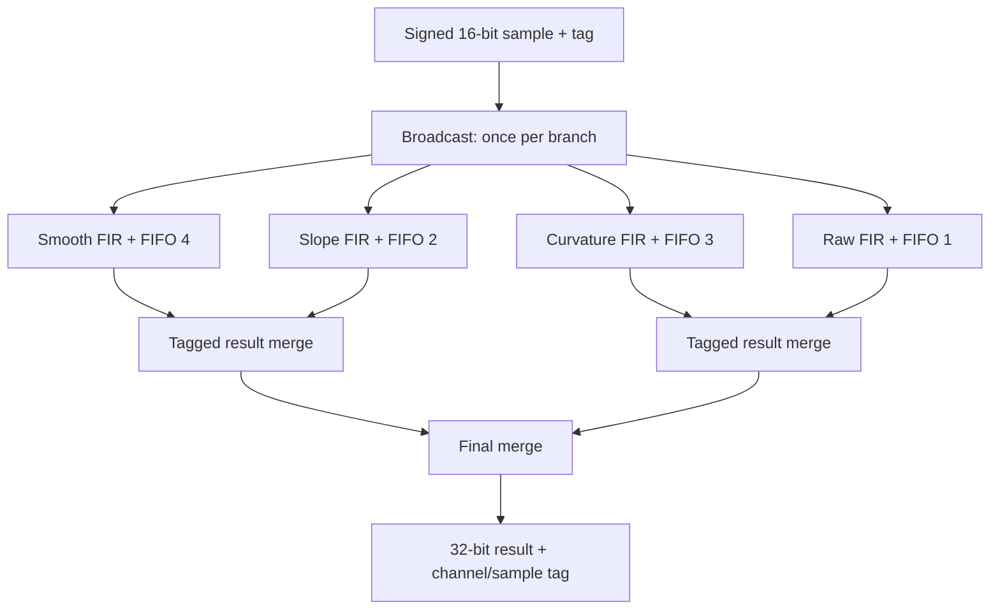

# A useful F# hardware example: a configurable streaming sensor monitor

Yes, this technique can be useful beyond an academic demonstration. Its strongest
case is generating families of related circuits from configuration, while sharing
software infrastructure for coefficients, test data and reference models. It is
less compelling as a replacement syntax for one small, fixed RTL block.

The new, executed example is a parallel filter bank. One stream of signed sensor
samples feeds several filters. Their outputs carry channel and sample tags and
are merged onto one result stream. This is a plausible building block for telemetry
feature extraction, vibration monitoring, or signal conditioning. It is not a
complete acquisition system or a qualified flight implementation.

## One list describes several actual datapaths

This is the actual default configuration in Designs.fs:

```fsharp
let monitorFilters =
    [ { Name="smooth"; Coefficients=[1;3;3;1]; QueueDepth=4 }
      { Name="slope"; Coefficients=[1;-1]; QueueDepth=2 }
      { Name="curvature"; Coefficients=[1;-2;1]; QueueDepth=3 }
      { Name="raw"; Coefficients=[1]; QueueDepth=1 } ]
```

The features are simple and interpretable:

| Channel | Calculation | Meaning |
|---:|---|---|
| 0 | x[n] + 3*x[n-1] + 3*x[n-2] + x[n-3] | Binomial smoothing, gain eight |
| 1 | x[n] - x[n-1] | First difference; changes in the signal |
| 2 | x[n] - 2*x[n-1] + x[n-2] | Second difference; changes in slope |
| 3 | x[n] | Raw signed sample for comparison |

These outputs are not calibrated derivatives: physical derivative units require
sample-period scaling. They do not implement anomaly thresholds, an FFT, spectral
power estimation or automatic event classification.

The same builder can accept other coefficient lists. Filter names must be unique
valid SharpHDL names; coefficients are signed integers, and results wrap to 32 bits.
The provided defaults cannot overflow for signed 16-bit samples. No arbitrary
coefficient range proof is performed. Queue depths are 1–256 entries.

## How the streams are wired



Arrows show the direction of payload and valid. Ready propagates backward along
each connection. The two-way handshake is part of every connection even though
the picture uses one arrow for readability.

Here is the actual central builder code:

```fsharp
let branches=StreamBlocks.Broadcast(m,input,"fanout",filters.Length)
let results =
    filters
    |> List.mapi (fun channel spec ->
        branches[channel]
        |> firStage m spec
        |> fun s -> StreamBlocks.Fifo(m,s,spec.Name+"_queue",spec.QueueDepth)
        |> tagChannel m channel (spec.Name+"_tag"))
results |> mergeTree m |> fun merged -> Stream.Connect(m,merged,output)
```

The supporting functions are in the same Designs.fs file. Nothing in this excerpt
is pseudocode. `firStage` elaborates registers and arithmetic expressions; Fifo
adds storage and flow control; tagChannel attaches a constant channel identifier;
mergeTree builds a tree of two-input arbiters.

The F# pipeline operator applies a builder to the stream returned by the previous
builder. It executes on the host. Its result is interconnected hardware, not a
software stream enumerator running in the FPGA.

### What a single connection means electrically

For `Stream.Connect(m, source, sink)`, SharpHDL adds these graph connections:

| Destination signal | Driver |
|---|---|
| sink.Data | source.Data |
| sink.Keep | source.Keep |
| sink.Last | source.Last |
| sink.User | source.User |
| sink.Valid | source.Valid |
| source.Ready | sink.Ready |

This is wiring with no added storage. Map adds an elastic register stage; Fifo
adds bounded storage. Connecting two streams is distinct from buffering them.

In the filter bank, each FIR output has one elastic stage, then its configured
FIFO. Channel tagging is combinational wiring. The merge tree consists of
combinational selection plus control registers that retain a grant under stalls.
There is no assumed implicit queue between every pair of functions.

### What is in an output result?

| Signal | Meaning |
|---|---|
| TDATA[31:0] | Signed 32-bit filter result |
| TUSER[15:8] | Filter/channel number, in configuration-list order |
| TUSER[7:0] | Original eight-bit sample tag |
| TKEEP | 0xf, all output bytes valid |
| TLAST | Always one; each result is a single-beat message |

Input TDATA is signed 16-bit; input TKEEP must be 3. The source supplies the sample
tag. Input TLAST is intentionally not used to reset history or delimit output
packets: this is a continuous-sample monitor. Turning every result into its own
message allows the packet-aware arbiters to switch channels after every result.

Results can be interleaved across channels. Each channel retains input sample
order. Downstream software must use the channel and sample tags, not assume a
specific global ordering. Tags are only eight bits and may wrap; the system must
supply suitable sequence context or use a wider metadata design if needed.

## Why ordinary fan-out would be wrong

Simply connecting the input Valid signal to several consumers is insufficient.
If consumer A is ready and B is stalled, A could accept the same held input on
several consecutive clocks. It would get duplicates while B waits.

Broadcast maintains one accepted flag per branch. Each branch is offered the
current input until it accepts it once. It then sees Valid=0 for that input.
The input is acknowledged only when every branch has accepted or can accept it.
The source must obey the usual rule: hold Valid and payload until acknowledged.

Here is a two-branch trace with sample X held at the input:

| Edge | A ready | B ready | A action | B action | Upstream action |
|---:|---:|---:|---|---|---|
| 1 | 1 | 0 | Accept X; remember delivery | Wait | Hold X |
| 2 | 1 | 0 | No duplicate; branch Valid=0 | Wait | Hold X |
| 3 | 1 | 1 | Already received X | Accept X | X accepted; advance next sample |
| 4 | 1 | 1 | Accept next sample | Accept next sample | Next sample accepted |

An individual branch may consume the held value before the aggregate upstream
handshake. This is intentional. The source cannot withdraw or change the offered
value while waiting. Global reset clears all accepted flags, FIR history and
queues, discarding in-flight work. Connected blocks must share that reset.

This example therefore does more than make arithmetic look nicer: its stream
library handles a real exactly-once-delivery problem under unequal branch stalls.

## Worked data flowing through the complete bank

Start with zero history and offer samples 8,0,0,0,0 with tags 0,1,2,3,4:

| Sample tag | Input | Smooth | Slope | Curvature | Raw |
|---:|---:|---:|---:|---:|---:|
| 0 | 8 | 8 | 8 | 8 | 8 |
| 1 | 0 | 24 | -8 | -16 | 0 |
| 2 | 0 | 24 | 0 | 8 | 0 |
| 3 | 0 | 8 | 0 | 0 | 0 |
| 4 | 0 | 0 | 0 | 0 | 0 |

Each row produces four independent output transactions, not one packed vector.
For sample tag 1, a slope result has User=0x0101 and Data=0xfffffff8 (-8).
A curvature result has User=0x0201 and Data=0xfffffff0 (-16). Their global output
order is determined by queue occupancy and the arbiters, so either may appear
first. Within each channel, tag 0 precedes tag 1.

FIR history advances on that branch's input handshake. A long stall does not
insert zero samples or advance the filter clock in sample space. Full queues
backpressure the branch, then the broadcast, then the source.

## The throughput limit is real

Four filter results per input and one result per output clock imply:

    sustained input rate <= output transaction rate / 4

With an always-ready output that accepts one result per clock, the four-channel
bank cannot sustain more than one new input sample per four clocks. Buffers absorb
bursts; they do not change this average-rate bound. Actual throughput may be lower
because of bubbles, arbitration and stalls. This release does not claim a mapped
clock frequency or prove that every configuration achieves the bound.

The merge tree is locally round-robin. A balanced four-channel tree is symmetric;
an unbalanced three-channel tree does not provide identical bandwidth shares to
all leaves. It is not a weighted or QoS scheduler.

To sustain one sample per clock with all four results, expose four output streams,
pack results into a sufficiently wide synchronized output, or reduce/decimate each
branch before merging. Those alternative topologies are not implemented by this
example. A real ADC often cannot be paused: connecting it to this slower merged
output requires an explicit buffering and overflow/rate-reduction policy. A
finite FIFO alone cannot fix a sustained rate mismatch.

## Where F# earns its keep

| Work | Why this approach helps | What it does not remove |
|---|---|---|
| Build 2, 3, 4 or more feature channels | One configuration list controls repeated topology | Resource and throughput budgeting |
| Change filter coefficients and queue sizes | Ordinary data drives construction and tests | Fixed-point scaling/overflow analysis |
| Share a software coefficient generator | Call existing .NET code at elaboration time | Verification of quantization |
| Compose reusable stream blocks | Functions encapsulate wiring/state/handshakes | Deadlock and backpressure design |
| Test with software reference models | Same .NET program can build stimuli and RTL | Independent HDL/post-synthesis checks |

A larger practical example might read a sensor-channel configuration, choose
per-channel coefficients and metadata, and generate the corresponding hardware
and host decoding tables together. Configuration-file import is a natural
extension, not part of this release.

SystemVerilog already supports generate loops and parameterized modules. Handwritten
RTL can implement exactly this circuit, potentially with better resource control.
F# is useful because it provides convenient host-side data structures, functions,
composition and access to the .NET ecosystem. It does not magically make the
resulting circuit faster or smaller.

The stream primitives are also useful from C#; this is not an F#-exclusive benefit.
F# mainly makes a configuration-driven design generator concise and readable.

## Where I would use it, and where I would not yet

I would use this as a prototype platform for configurable DSP/telemetry datapaths,
especially when several related hardware variants must stay synchronized with
software models and tests. For a tiny fixed counter, conventional RTL is simpler.

For a production FPGA project, the present library still needs target-specific
implementation evidence, more extensive protocol verification, RAM-backed queues,
registered-ready timing cuts, CDC support and stronger numeric typing/error
policies. It has no automatic retiming, resource sharing or timing closure.
Widths are checked during elaboration rather than encoded in F#'s type system.
It is a tested proof of a useful design method, not yet a mature replacement for
a commercial HDL toolchain.

## Actual verification in this release

The same F# builder generated two-, three- and four-channel circuits. Each took
96 signed input samples with source bubbles and long/random output stalls:

| Channels | Accepted input samples | Output results | Simulation cycles including imposed stalls |
|---:|---:|---:|---:|
| 2 | 96 | 192 | 373 |
| 3 | 96 | 288 | 515 |
| 4 | 96 | 384 | 647 |

Independent integer convolution checked each channel. Scoreboards checked channel
identity, per-channel sequence, duplicates, missing samples, payload stability
under stalls and eventual drain. These cycle counts describe the randomized test,
not peak performance measurements.

The F# suite passed 7,959 assertions across six emitted designs. All three new
banks also passed Icarus simulation, Yosys RTL synthesis/checks and post-synthesis
Icarus simulation. These are finite regressions, not a universal deadlock or
formal equivalence proof. Generated graph dumps, Verilog, testbenches and logs
are included for inspection.

To build just a particular bank in F#:

```fsharp
let m, input, output = Designs.filterBank Designs.monitorFilters
System.IO.File.WriteAllText("monitor.graph.txt", m.DumpGraph())
System.IO.File.WriteAllText("monitor.v", m.Verilog())
System.IO.File.WriteAllText("monitor_axi.v", Axi4Stream.Wrapper(m))
```

Use `Designs.monitorFilters |> List.take 2` for the two-channel variant. Run the
example suite with `dotnet run --project examples/FSharp/Examples.fsproj -- generated/fsharp`,
or the supplied direct-compiler route. See FSharp/README.md for setup.

## Compare the actual hand-written RTL

A complete [hand-written Verilog implementation](../Verilog/README.md) is now
included. Its four branches, FIFO sizes, broadcast and merger behavior match
the default F# design. It passed the exact same cycle-by-cycle testbench both
before and after synthesis. The comparison explains which details the stream
library supplies, and which are equally natural to express directly in RTL.
