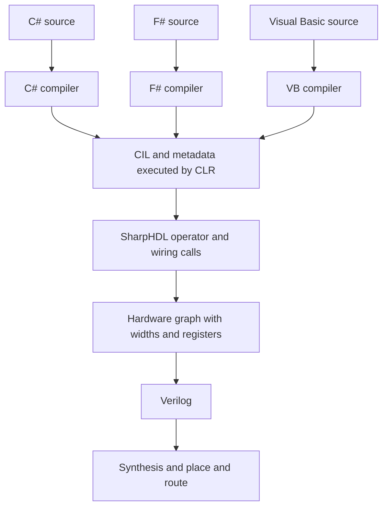

# Three languages one circuit

These are executable C#, F# and Visual Basic examples, not translations shown
only in documentation. They are compiled into three separate .NET assemblies,
loaded by a C# harness, and used to build and test real SharpHDL hardware graphs.

## The distinction that makes the explanation accurate

**CIL is the common software language; the SharpHDL graph is the common hardware
language.** The language compilers resolve syntax, types, overloads and method
calls. The CLR executes those compiled methods. SharpHDL's operators and module
methods construct the explicit hardware graph. The Verilog writer traverses
that graph; synthesis maps its arithmetic and state into FPGA resources.

The current implementation does not inspect CIL to synthesize a circuit. The
CIL disassembler included here is an educational observer, not a frontend.
Ordinary `int a = b + 2` would calculate a software integer. Using `Expr` changes
what `+` means: it calls a library routine which creates an adder node.



CIL is crucial to .NET interoperability, together with the common type system,
metadata and runtime calling conventions. It is not itself a description of
FPGA clocks, widths or parallelism. Compilers can emit different CIL and still
construct the same hardware graph.

## A equals B plus two in three real source files

C# (`CSharpPiece.cs`):

```csharp
public static Expr AddTwo(Expr b)
{
    var a = b + Expr.Const(8, 2);
    return a;
}
```

F# (`FSharpPiece.fs`):

```fsharp
let AddTwo (b: Expr) =
    let a = b + Expr.Const(8, 2I)
    a
```

Visual Basic (`VisualBasicPiece.vb`, with Option Strict and Option Infer On):

```vb
Public Function AddTwo(b As Expr) As Expr
    Dim a = b + Expr.Const(8, 2)
    Return a
End Function
```

The surrounding `Build` functions declare eight-bit input B and output A, then
connect A using `m.Drive(a, AddTwo(b))`. Local `a` in the function is a .NET
reference to an expression; it does not allocate a hardware register.
`Drive` makes a combinational connection. Use `Next` on a declared register
when the result must change only at a clock edge.

The exact hardware graph from all three builds is:

```text
module AddTwo
input b : bits[8]
output a : bits[8]
expressions:
e0 : bits[8] const 2
e1 : bits[8] + (b, e0)
connections:
a <- e1
```

The actual generated Verilog contains:

```verilog
wire [7:0] n_add_0;
assign n_add_0 = s_b + 8'd2;
assign s_a = n_add_0;
```

This is one combinational eight-bit add-by-two network. It is modulo 256:
B=7 gives A=9; B=254 gives A=0. All 256 possible inputs are checked for each
language. The harness also compares the complete graph dumps and generated
Verilog strings for exact equality. Target synthesis can further optimize a
constant adder into carry/XOR logic; identical output here does not mean every
possible synthesis setting or physical placement yields identical routing.

## From the adder to FPGA primitives

The mapped iCE40 netlist is also included as `AddTwo_mapped.v`. This build uses
seven SB_LUT4 cells and five SB_CARRY cells, with no flip-flops. Its synthesized
netlist passes the same exhaustive 256-input HDL test. The first bit is just a
wire; the constant two enters at bit one. The equivalent logic starts as:

```text
A[0] = B[0]
A[1] = NOT B[1]
A[2] = B[2] XOR B[1]
A[3] = B[3] XOR (B[2] AND B[1])
```

The carry continues through the higher bits. A ninth output bit would preserve
the final carry; this eight-bit example intentionally discards it. LUT and carry
counts refer to this Yosys iCE40 mapping, not every FPGA family or tool setting.

## Actual CIL decomposition

`generated/three-languages/actual-cil.txt` is decoded from the compiled method
bodies using .NET reflection. With the supplied .NET 8 compiler invocation,
the hardware-building C# and VB methods both emit:

```text
ldarg.0                 // push the reference to expression B
ldc.i4.8                // push the requested hardware width
ldc.i4.2                // push the host constant value
call BigInteger.op_Implicit(Int32)
call Expr.Const(Int32, BigInteger)
call Expr.op_Addition(Expr, Expr)
ret
```

F# differs at constant construction: it emits `newobj BigInteger::.ctor(Int32)`
instead of `op_Implicit`. It then calls exactly the same `Expr.Const` and
`Expr.op_Addition` methods. At execution, the first creates an eight-bit constant
node; the second links B and that constant to an eight-bit addition node.
Neither call has to know the future value on FPGA input B.

The ordinary host integer examples are deliberately included as a contrast
needed to avoid an incorrect conclusion. C# in explicit unchecked context and
the supplied F# build emit `ldarg.0; ldc.i4.2; add; ret`. Default checked VB emits
`add.ovf`. Thus ordinary source that looks equivalent can have different overflow
semantics. The harness checks that VB throws on `Integer.MaxValue + 2`, while
the unchecked C# version wraps. Hardware overflow semantics come from our
explicit-width API, not a blanket assumption that all CIL is identical.

## Why an intermediate representation exists

A shared intermediate form lets multiple language compilers target a common
runtime, while runtime implementations support different processors. Language
frontends handle parsing, name resolution and type checking; the runtime can
handle execution, code generation and shared services without understanding
three separate source syntaxes. Metadata lets an F# caller discover a C# type
and a VB method signature without reparsing their source files.

SharpHDL uses a second intermediate representation for a different job. Its
nodes describe exact bit widths, connectivity, combinational operations and
clocked state. The same graph supports simulation, graph inspection and HDL
emission. This is why adding the VB example did not require a new Verilog backend.

Could we instead read CIL and recover hardware? Yes, for a deliberately limited
subset, but that would be a different compiler frontend. It would need control
flow/data-flow analysis, width rules, a clock and scheduling model, bounded
loops, memory/aliasing rules, and policies for exceptions and heap allocation.
A CIL `add` instruction does not say whether to instantiate another adder, reuse
one over time, or insert a register. The CLR's JIT intermediate representations
are generally designed for CPU execution, not a stable hardware interchange API.
Our library avoids that analysis by recording hardware intent during execution.

Authoritative background on the software compilation path:
https://learn.microsoft.com/en-us/dotnet/standard/managed-execution-process
The descriptions of SharpHDL behavior above come from this implementation and
its executed tests, not from Microsoft's documentation.

## Mix F Sharp a C Sharp skid buffer and Visual Basic

The actual C# harness connects methods from the three separately compiled DLLs:

```csharp
var fsharp = FSharpPiece.AddStage(m, input);
var buffered = StreamBlocks.SkidBuffer(m, fsharp, "csharp_skid");
var result = VisualBasicPiece.MultiplyStage(m, buffered);
Stream.Connect(m, result, output);
```

F# constructs an elastic `+2` stage. The C# skid implementation constructs head
and spill registers and flow control. VB constructs an elastic `×3` stage.
The interface object is the same `SharpHDL.Stream` CLR type in every assembly.
After elaboration, all three contributions belong to one hardware graph;
the FPGA has no F# runtime, VB runtime or inter-language function-call overhead.

Forward Data/Keep/Last/User/Valid travel from input through the three blocks.
Ready flows back from the output, and the skid buffer breaks that combinational
ready path. It stores **two beats**, not two clocks of mandatory delay. Its
minimum forward latency is one cycle, making the complete pipeline three
cycles with no stalls. Payload is `((B+2) mod 256)×3 mod 256`; Last, Keep and
User accompany each accepted beat. This example treats all eight payload bits
as arithmetic regardless of Keep; Keep is transported, not a byte arithmetic mask.

## Explicit C Sharp pipelining

One `Map` call means one elastic output register stage, even if its lambda has
several operators:

```csharp
var result = StreamBlocks.Map(m, input, "one_stage", 8,
    b => (b + Expr.Const(8,2)) * Expr.Const(8,3));
```

Two `Map` calls put storage between the add and multiply:

```csharp
var added = StreamBlocks.Map(m, input, "add_stage", 8,
    b => b + Expr.Const(8,2));
var result = StreamBlocks.Map(m, added, "multiply_stage", 8,
    a => a * Expr.Const(8,3));
```

| Design | Minimum latency | Unstalled throughput | Placement of arithmetic |
|---|---:|---:|---|
| One Map | 1 cycle | 1 beat per cycle | Add and multiply before one register stage |
| Two Maps | 2 cycles | 1 beat per cycle | Add and multiply separated by a register stage |
| F# plus skid plus VB | 3 cycles | 1 beat per cycle | Separate arithmetic stages and a two-entry timing buffer |

A token accepted at edge 1 becomes visible immediately after edge 1 in the
one-stage design and can be accepted by the next consumer at edge 2. In the
two-stage version it becomes visible after edge 2 and is accepted at edge 3.
The latency tests count these input-accept to output-accept edge intervals.
Stalls increase elapsed latency; they never permit a payload to be overwritten.

Separating source statements or introducing local variables alone does not
insert registers. Neither does a C# `for` loop imply successive FPGA clocks:
it runs during elaboration and can create multiple parallel blocks. Splitting
a combinational path can improve achievable frequency, but the improvement
must be measured after target implementation. No automatic retiming is claimed.

## Reproduce

Install .NET 8 SDK and Icarus Verilog, then from the repository root:

```sh
SDK_ROOT=/path/to/dotnet-sdk tests/run-three-languages.sh
```

The Python build invokes the SDK's real C#, F# and VB compilers without NuGet.
It emits three language DLLs plus the harness. `SDK_ROOT` is the installation
containing `dotnet`, `sdk` and `packs`, not the versioned SDK subdirectory.
Generated CIL, graphs, source Verilog, self-checking HDL benches and measured
latencies are included under `generated/three-languages`.

Try Add two and wrap in the [workbook WASM lab](../../WASM_WORKBOOK.md).
It runs this generated AddTwo hardware and shows eight-bit wrap at 254 + 2.
